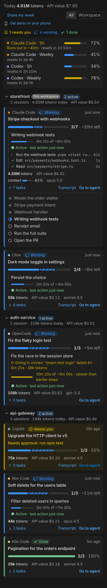
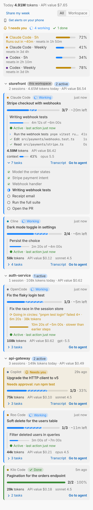

# Kvali

**One progress bar for every AI coding agent.**
Live task progress, the current step, tokens, cost and plan limits for Claude Code, Codex, Gemini CLI, Antigravity — and any other agent that reads `AGENTS.md`. Grouped by project, right inside VS Code, Antigravity, Cursor or Windsurf, or in your terminal.

<p align="center">
  
  &nbsp;&nbsp;
  
</p>

> *Kvali* (კვალი) is Georgian for "trace": every agent leaves one on disk. Kvali reads it so you never have to type "what's the progress?" again.

## Why

Long agent runs are a black box. You either babysit the chat or keep asking for a status update, which costs tokens and breaks the agent's flow. Meanwhile, every agent already writes everything Kvali needs to your disk: its plan, the tool it is running, and the tokens it spent. Kvali turns that into:

- **Progress to 100%**: the agent's own plan (Claude Code Tasks, Codex `update_plan`, Gemini `write_todos`, Antigravity `task.md`) as a progress bar with the step it is on.
- **What it is doing right now**: "Running `pnpm test` · 41s", "Editing `src/app.tsx`", the last few actions, and how long the current step is taking compared with the earlier ones ("4m of ~6m").
- **Stuck or working?** Each working agent shows whether it is active, waiting for a long command, retrying after a connection/API error, or silent with nothing running. With the [Claude Code plugin](#claude-code-plugin) this is exact for Claude Code: thinking, writing, running a tool, waiting for you, no data from the API, or closed.
- **Needs you**: permission prompts and questions surface in the status bar and as notifications, including OS notifications when the editor is in the background.
- **On your phone**: the same alerts as push notifications through the free [ntfy](https://ntfy.sh) app (iPhone and Android), for every agent. See [Phone notifications](#phone-notifications).
- **Tokens and API value**: per session, per project and per day, with input, output, cache and context usage. API value is what the tokens would cost at list prices (built in for Anthropic models, configurable for others); subscriptions are not billed per token.
- **Plan limits**: 5-hour and weekly usage for Codex subscriptions, straight from Codex's own logs.
- **Every project at once**: sessions are grouped by project; the current workspace comes first.

Everything is local and read-only. Kvali sends nothing anywhere unless you turn on phone notifications, and then only short status lines (agent, project, step, progress), never code or prompts.

## Supported agents

| Agent | Progress from | Current step | Tokens | Cost | Plan limits | "Needs you" |
| --- | --- | --- | --- | --- | --- | --- |
| **Claude Code** (CLI, VS Code, Desktop) | Tasks / TodoWrite | ✓ | ✓ incl. subagents | ✓ built in | — | ✓ with hooks¹ |
| **Codex** (CLI, IDE) | `update_plan` | ✓ | ✓ | via `kvali.pricing` | ✓ 5h + weekly | — |
| **Gemini CLI** | `write_todos` | ✓ | ✓ | via `kvali.pricing` | — | ✓ |
| **Antigravity** agent | `task.md` | ✓ | not stored locally | — | — | ✓ |
| **Anything that reads AGENTS.md** — Cursor, Copilot, Windsurf, Cline, Aider, … | [`.agents/progress.md`](docs/PROTOCOL.md) | ✓ | — | — | — | ✓ |

¹ Claude Code's transcript does not record permission prompts. One click installs four tiny async hooks that report them (see [Claude Code hooks](#claude-code-hooks)). Without hooks, everything else still works.

Want another agent? Adapters are small; see [docs/ADAPTERS.md](docs/ADAPTERS.md).

## Claude Code plugin

Use Claude Code without an editor (terminal, desktop app), or want exact liveness? Kvali also ships as a Claude Code plugin ([packages/claude-plugin](packages/claude-plugin)): a pane beside the chat with the plan's progress bar, the current step and its time, what Claude is doing right now and the session's tokens, plus a status line entry. It reads Claude Code's own events (the model's stream, tool calls, permission prompts), so it never has to guess whether the agent is thinking or stuck.

```bash
claude plugin marketplace add /path/to/kvali
claude plugin install kvali@kvali
```

With the editor extension installed too, the plugin's heartbeat (`~/.kvali/live/claude-code/<session>.mod.json`) makes the sidebar exact for every Claude Code session, and a Claude Code that was closed or froze mid-task is reported within 30 seconds.

## Phone notifications

Get a push on your phone when an agent needs you, finishes a long task (two minutes or more), fails, or goes quiet, for every agent Kvali sees.

1. At the top of the Kvali view click **Get alerts on your phone** (or run **Kvali: Send Notifications to My Phone**, or `kvali phone` in a terminal). Kvali makes a private topic and shows a QR code.
2. Install the free **ntfy** app. On Android scan the code; on an iPhone tap **+** in ntfy and enter the topic.
3. A test notification arrives. That's it.

- **Who sends**: the editor window that holds the hook port (one per machine, so each event arrives once), `kvali` or `kvali watch` (no dashboard, for terminal-only setups). Kvali's Claude Code plugin sends for its own sessions by itself, with exact "needs you" and "no data from the API" alerts.
- **What a push says**: the agent, the project, the step and progress, for example "Claude Code needs you · storefront / Needs approval: Bash / 3/7 tasks · Writing tests". Never code or prompts. `kvali phone --private` leaves out project and step names too.
- **Privacy**: on ntfy.sh anyone who knows a topic's name can read it, so Kvali generates an unguessable one (80 random bits). Keep it to yourself, or use your own ntfy server: `kvali phone --server https://ntfy.example.com --token tk_…`.
- **More or fewer**: `kvali phone --steps` adds a push for each finished step. The setup is `~/.kvali/config.json` (`phone.events`: `needs-you`, `done`, `error`, `stuck`, `steps`). **Kvali: Stop Phone Notifications** or `kvali phone off` turns it off.
- Using Claude Code with a Pro or Max plan? Claude's own [Remote Control](https://code.claude.com/docs/en/remote-control) also shows a session in the Claude app with push notifications; Kvali adds every other agent and one view of all of them.

## Install

**Editor extension** (VS Code ≥ 1.90, Antigravity, Cursor, Windsurf, VSCodium):

- From a release: download `kvali-x.y.z.vsix`, then run **Extensions: Install from VSIX…** from the Command Palette (or `code --install-extension kvali-x.y.z.vsix`).
- From source: `pnpm install && pnpm package`, which writes `packages/vscode/kvali-0.5.1.vsix`.

Open the **Kvali** icon in the activity bar and click **Turn on** once. That is the whole setup: Kvali finds the agents on your machine, turns on "needs you" alerts and makes every agent keep a plan, so each task gets a real progress bar. Sessions from the last 24 hours appear automatically.

**Terminal** (any editor, including JetBrains):

```bash
pnpm install && pnpm build
node packages/cli/dist/kvali.mjs          # live dashboard, q to quit
node packages/cli/dist/kvali.mjs --here   # only this project
node packages/cli/dist/kvali.mjs --json   # one snapshot as JSON, for scripts
```

## What "Turn on" does

One consent, everything marked and reversible (also `kvali setup` / `kvali setup off` in a terminal):

| Agent found | Change | Why |
| --- | --- | --- |
| Claude Code | 4 hooks in `~/.claude/settings.json` | Exact "Needs you" status; while a session has no unfinished plan, the prompt hook asks Claude to keep a task list (~60 tokens, only then) |
| Codex | a 4-line rule in `~/.codex/AGENTS.md` | Codex keeps an `update_plan` list for multi-step work |
| Gemini CLI / Antigravity | the same rule in `~/.gemini/GEMINI.md` | `write_todos` / `task.md` for multi-step work |

- Your own settings and text are never changed; Kvali only adds its marked entries.
- Kvali keeps them current after updates, and **uninstalling the extension removes all of them** automatically.
- **Kvali: Turn Off** removes them while keeping the extension.
- Without a plan (before the agent writes one, or with setup off) Kvali still shows an indeterminate bar with the steps taken this turn.
- Agents Kvali cannot configure (Cursor, Copilot, …): run **Kvali: Add Progress Protocol to AGENTS.md** in a repository.
- Codex / Gemini on API keys: add prices in `kvali.pricing` to see their API value (tokens are always shown).

## Claude Code hooks

The hooks are plain `curl` commands that send the event JSON to Kvali on `127.0.0.1:47821` (bypassing any HTTP proxy) and always exit 0:

```bash
# UserPromptSubmit (synchronous, capped at 1 s, usually a few ms): may print Kvali's planning reminder
curl -s --noproxy '*' -m 1 --connect-timeout 0.3 -H 'Content-Type: application/json' --data-binary @- http://127.0.0.1:47821/v1/events/claude-code || true
# Notification, Stop, SessionEnd (async, fire and forget)
curl -s --noproxy '*' -m 2 -o /dev/null -H 'Content-Type: application/json' --data-binary @- http://127.0.0.1:47821/v1/events/claude-code || true
```

- When no editor with Kvali is running, nothing answers and Claude Code continues as if the hooks did not exist.
- Kvali stores only the event name, session id, notification type and message in `~/.kvali/live/`. Prompts, tool inputs and code are never stored. The planning reminder is a fixed text and never contains anything from your prompt.
- Claude Code reports when a permission prompt appears, but not the moment you approve it. Kvali clears "Needs you" as soon as the transcript moves on, so a long command you approved may show "Needs you" until it finishes.
- Set `kvali.autoPlan` to `false` to keep the alerts but stop the planning reminder.

## Settings

| Setting | Default | |
| --- | --- | --- |
| `kvali.scope` | `all` | `all` projects (this workspace first) or only `workspace` |
| `kvali.activeWindowHours` | `24` | How far back sessions are shown |
| `kvali.staleAfterMinutes` | `30` | A working session that goes quiet this long is marked stale |
| `kvali.notifications.onFinish` | `true` | Notify when an agent finishes |
| `kvali.notifications.onNeedsInput` | `true` | Notify when an agent needs you |
| `kvali.notifications.system` | `true` | Also use macOS / Linux notifications when the editor is in the background |
| `kvali.statusBar.enabled` | `true` | Status bar item for this workspace |
| `kvali.autoPlan` | `true` | Remind Claude Code to keep a plan while a session has none |
| `kvali.cost.show` | `true` | Show API value (what the tokens would cost at API list prices) |
| `kvali.pricing` | `{}` | Prices in USD per million tokens, e.g. `{ "gpt-5.5*": { "input": 1.25, "output": 10, "cacheRead": 0.125 } }` |
| `kvali.agents.disabled` | `[]` | Agents Kvali should not read |
| `kvali.antigravity.brainDirs` | `[]` | Extra Antigravity data folders |
| `kvali.hooks.port` | `47821` | Local port for agent hooks |

## How it works

```
 Claude Code ─┐ ~/.claude/projects/*.jsonl, ~/.claude/tasks/
 Codex ───────┤ ~/.codex/sessions/YYYY/MM/DD/rollout-*.jsonl
 Gemini CLI ──┤ ~/.gemini/tmp/*/chats/session-*.jsonl          ┌──────────────┐    ┌───────────────────┐
 Antigravity ─┤ ~/.gemini/antigravity-ide/brain/*/  ──▶ adapters ─▶│ @kvali/core  │──▶ │ VS Code extension │
 AGENTS.md ───┘ <repo>/.agents/progress.md                      │ engine       │    │ CLI dashboard     │
 agent hooks ──▶ 127.0.0.1:47821 ──▶ ~/.kvali/live/ ──────────────▶│ (normalizes) │    └───────────────────┘
                                                                └──────────────┘
```

- `packages/core` is editor-agnostic. Each adapter tails its agent's files incrementally (only appended bytes are read) and produces one normalized `AgentSession` model: status, plan, current activity, tokens, cost, context and limits.
- `packages/vscode` renders the model as a sidebar view, a status bar item and notifications.
- `packages/cli` renders the same model in a terminal.

## Development

```bash
pnpm install
pnpm test        # adapter and engine tests (node:test, no extra deps)
pnpm typecheck
pnpm build
```

Press <kbd>F5</kbd> in VS Code to launch an Extension Development Host. See [CONTRIBUTING.md](CONTRIBUTING.md).

## Roadmap

- Claude Code plan limits (5h / weekly) through a status line bridge
- Adapters: Cursor, GitHub Copilot CLI, Cline / Roo Code / Kilo Code, OpenCode, Qwen Code, Aider
- Codex and Gemini CLI hooks for exact "needs approval" status
- Per-project token budgets with alerts
- A Claude Code mod that draws progress inside Claude Code's own panel

## License

[MIT](LICENSE) © 2026 Giorgi Khiladze
