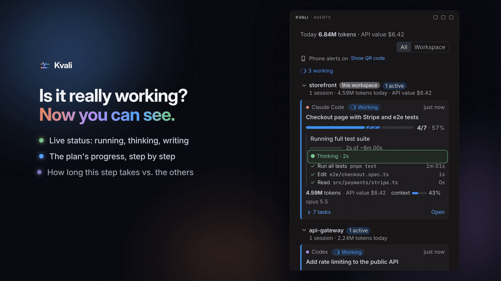

# Kvali — AI Agent Progress Tracker

**One progress bar for every AI coding agent.** Stop asking your agent "what's the progress?". Kvali shows the plan, the current step, the time left, tokens, cost and plan limits of Claude Code, Codex, Gemini CLI, Antigravity, GitHub Copilot, Cline, Roo Code, Kilo Code, OpenCode and any agent that reads `AGENTS.md`, grouped by project.

## Features

- **Progress to 100%** from the agent's own plan (Claude Code Tasks, Codex `update_plan`, Gemini `write_todos`, Antigravity `task.md`, Copilot `update_todo`, Cline's focus chain, Roo Code's todo list, OpenCode's `todowrite`, or the [progress protocol](https://github.com/webGrandpa/kvali/blob/main/docs/PROTOCOL.md)).
- **Time left**: "~20m left", from how long the plan's earlier steps took.
- **What it is doing right now**: the step, the tool or command, and for how long.
- **Needs you**: permission prompts and questions in the status bar and as notifications, including OS notifications when the editor is in the background.
- **Going in circles**: the same action failing again and again with the same error is flagged, with the tokens it cost.
- **Go to agent**: one click from a card or a notification to the terminal, window or panel the agent runs in.
- **On your phone**: click **Get alerts on your phone** at the top of the Kvali view and scan the QR code with the free ntfy app, or use a Telegram bot or a Discord channel. Choose what reaches it: each finished step or every action as one silent live notification per task, a task done, an error, an agent gone silent or going in circles, a plan limit about to run out, a question that waited a minute.
- **Tokens and API value** per session, project and day, with context-window usage. Anthropic prices are built in; set `kvali.pricing` for other models.
- **Plan limits with a forecast**: 5-hour and weekly usage of Claude Code (with Kvali's plugin) and Codex subscriptions, and when each runs out at the current pace.
- **Share your week**: your agents' last seven days as an image to post on X or LinkedIn, counts only.
- **All projects in one place**, this workspace first. **Resume** a finished Claude Code or Codex session in a terminal with one click.

Everything is local and read-only, with no telemetry. Kvali sends nothing anywhere unless you turn on phone notifications, and then only short status lines (agent, project, step, progress), never code or prompts. See the [privacy notes](https://github.com/webGrandpa/kvali/blob/main/PRIVACY.md).

## Supported agents

| Agent | Progress | Tokens | Cost | Limits | Needs you |
| --- | --- | --- | --- | --- | --- |
| Claude Code | ✓ | ✓ | ✓ | ✓ with the plugin | ✓ exact, with the plugin |
| Codex | ✓ | ✓ | custom prices | ✓ | — |
| Gemini CLI | ✓ | ✓ | custom prices | — | ✓ |
| Antigravity | ✓ | — | — | — | ✓ |
| GitHub Copilot (CLI, VS Code chats on its runtime) | ✓ | ✓ | ✓ | — | ✓ exact |
| Cline | ✓ | ✓ | ✓ | — | ✓ |
| Roo Code | ✓ | ✓ | ✓ | — | ✓ |
| Kilo Code | ✓ | ✓ | ✓ | — | questions |
| OpenCode | ✓ | ✓ | ✓ | — | ✓ exact |
| Cursor, Windsurf, Aider, … via AGENTS.md | ✓ | — | — | — | ✓ |

OpenCode and Kilo Code are read with the editor's built-in SQLite (VS Code 1.10x and the editors built on it).

## Getting started

1. Open the **Kvali** view from the activity bar. Sessions from the last 24 hours appear automatically.
2. Click **Turn on** once. Kvali enables "needs you" alerts and automatic plans for every agent it finds (Kvali's Claude Code plugin, installed with Claude Code's own command, and a short planning rule for Codex and Gemini/Antigravity). All of it is marked, reversible with **Kvali: Turn Off**, and removed automatically when you uninstall Kvali.

Full documentation, the terminal dashboard and the source are on [GitHub](https://github.com/webGrandpa/kvali).

[Privacy](https://github.com/webGrandpa/kvali/blob/main/PRIVACY.md) · [Security policy](https://github.com/webGrandpa/kvali/blob/main/SECURITY.md) · [Third-party notices](https://github.com/webGrandpa/kvali/blob/main/THIRD_PARTY_NOTICES.md) · MIT License

Kvali is an independent open-source project, not affiliated with or endorsed by Anthropic, OpenAI, Google, Microsoft or the makers of the other tools it works with. Claude Code, Codex, Gemini CLI, Antigravity, GitHub Copilot, Cline, Roo Code, Kilo Code, OpenCode, VS Code, Cursor, Windsurf, Telegram, Discord and the other product names here are trademarks of their owners, used only to say what Kvali works with.
