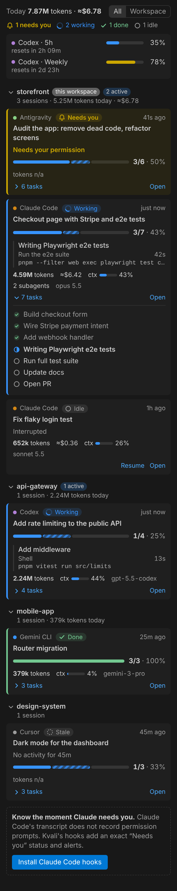

# Kvali — AI Agent Progress & Tokens

**One progress bar for every AI coding agent.** Stop asking your agent "what's the progress?". Kvali shows the plan, the current step, tokens, cost and plan limits of Claude Code, Codex, Gemini CLI, Antigravity and any agent that reads `AGENTS.md`, grouped by project.

## Features

- **Progress to 100%** from the agent's own plan (Claude Code Tasks, Codex `update_plan`, Gemini `write_todos`, Antigravity `task.md`, or the [progress protocol](https://github.com/webGrandpa/kvali/blob/main/docs/PROTOCOL.md)).
- **What it is doing right now**: the step, the tool or command, and for how long.
- **Needs you**: permission prompts and questions in the status bar and as notifications, including OS notifications when the editor is in the background.
- **Tokens and cost** per session, project and day, with context-window usage. Anthropic prices are built in; set `kvali.pricing` for other models.
- **Plan limits**: 5-hour and weekly usage for Codex subscriptions.
- **All projects in one place**, this workspace first. **Resume** a finished Claude Code or Codex session in a terminal with one click.

Everything is local and read-only. Kvali never sends your data anywhere.

## Supported agents

| Agent | Progress | Tokens | Cost | Limits | Needs you |
| --- | --- | --- | --- | --- | --- |
| Claude Code | ✓ | ✓ | ✓ | — | ✓ with hooks |
| Codex | ✓ | ✓ | custom prices | ✓ | — |
| Gemini CLI | ✓ | ✓ | custom prices | — | ✓ |
| Antigravity | ✓ | — | — | — | ✓ |
| Cursor, Copilot, Windsurf, Cline, Aider, … via AGENTS.md | ✓ | — | — | — | ✓ |

## Getting started

1. Open the **Kvali** view from the activity bar. Sessions from the last 24 hours appear automatically.
2. Run **Kvali: Add Progress Protocol to AGENTS.md** in each repository so every agent keeps its plan visible.
3. Claude Code users: run **Kvali: Install Claude Code Hooks** for an exact "Needs you" status.

Full documentation, the terminal dashboard and the source are on [GitHub](https://github.com/webGrandpa/kvali).
